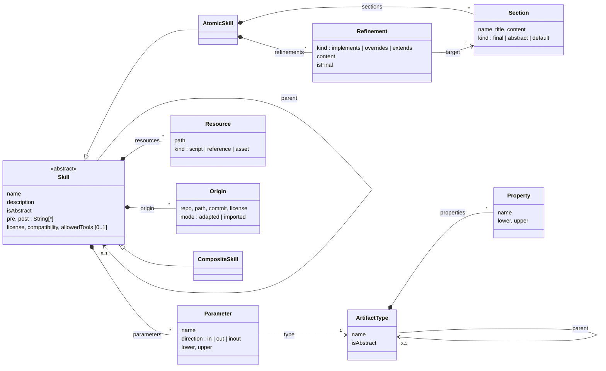
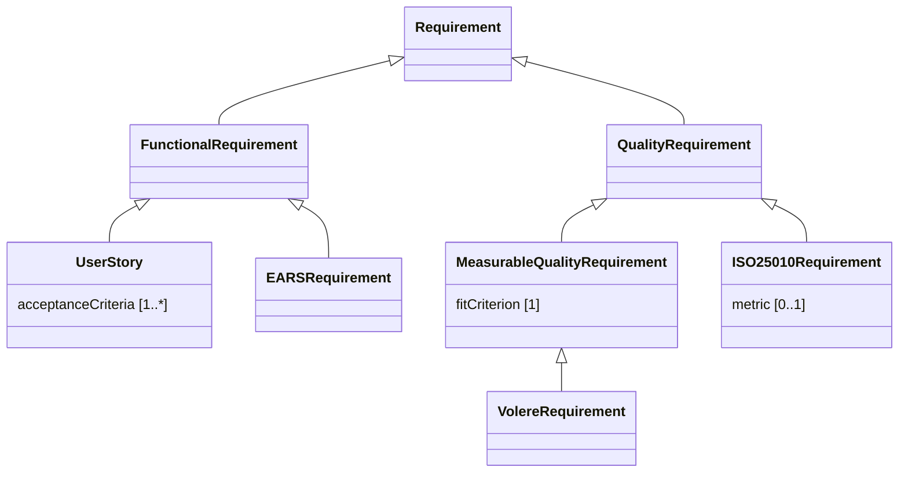
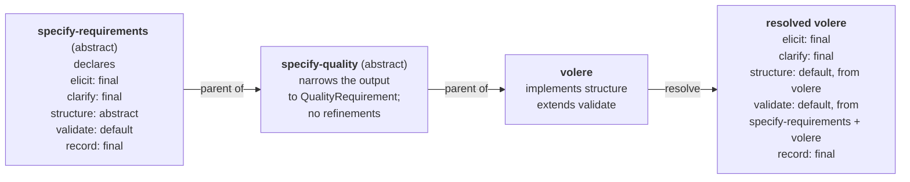
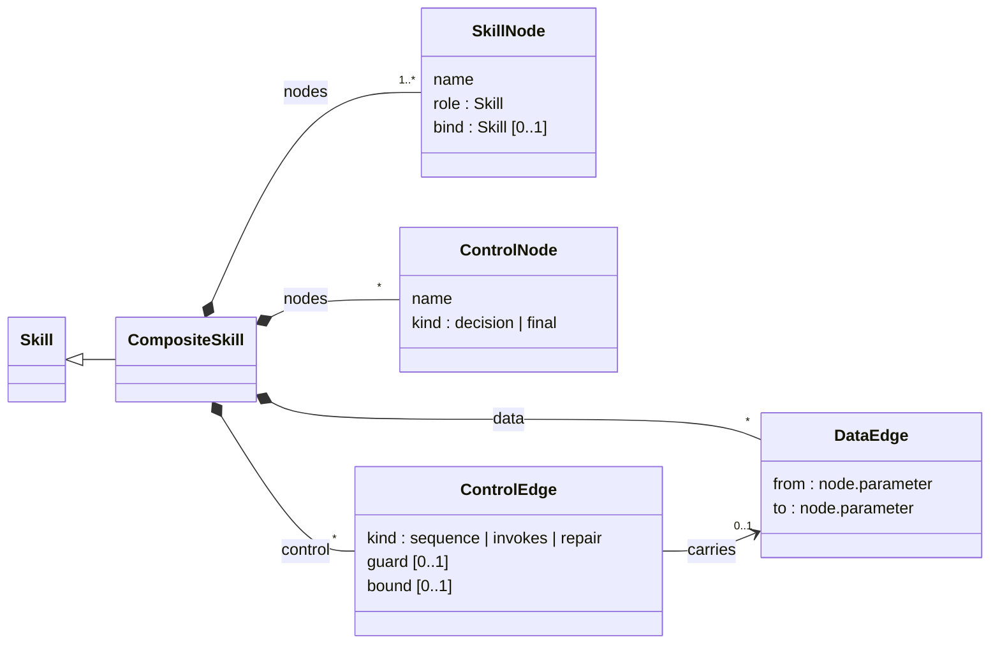

# The DEFT metamodel

DEFT describes a skill library along two dimensions:

- **Specialization**: skills form hierarchies. A parent holds the procedure that every
  variant shares; descendants fill or change its variation points.
- **Composition**: skills form workflows. Steps exchange typed artifacts and declare
  what they need and what they guarantee.

The two dimensions meet at **binding time**. A specialization may accept a narrower
input than its parent (an acceptance-test skill accepts only user stories), so whether
a workflow is valid depends on which specializations it binds. DEFT accepts the
narrowing in the hierarchy and checks it where the specialization is bound.

The executable definition is [`deft/model.py`](../deft/model.py). The same metamodel
is available in Ecore ([`metamodel/deft.ecore`](../metamodel/deft.ecore)), with its
constraints in OCL ([`metamodel/deft.ocl`](../metamodel/deft.ocl)).

## Specialization

### Skills and sections

A skill is either **atomic**, with a body of sections, or **composite**, with a
workflow graph as its body (see [Composition](#composition)). A skill specializes
only skills of its own kind. Every skill has the fields of the Agent Skills
specification: name, description, bundled resources, and the optional `license`,
`compatibility`, `allowed-tools` and `metadata`. Descendants inherit the optional
fields and may redeclare them; generated skills carry the library's licence unless
a skill declares its own. In addition, every skill has:

- **Parameters**: inputs (`in`), outputs (`out`) and artifacts the skill receives and
  updates in place (`inout`, both an input and an output), each typed by an artifact
  type, with a multiplicity `[lower..upper]` that says how many artifacts it carries.
  An input with `lower = 0` is optional.
- **Pre- and postconditions** in natural language. Descendants inherit them and may add
  more.
- **Origin**: where reused material comes from (repository, commit, licence), either
  `adapted` (rewritten) or `imported` (used verbatim). A skill written from scratch has
  no origin.

An atomic skill's body is a list of **sections**, the blocks of instructions, of three
kinds. They follow the template method pattern, with the keywords of object-oriented
languages:

| Kind | Meaning | Descendants may |
|---|---|---|
| `final` | Procedure every member of the family follows | nothing |
| `abstract` | Variation point without content | `implements` it (concrete skills must) |
| `default` | Content that some members change | `overrides` or `extends` it |

A refinement changes the kind of the section it refines, for the skill that refines
it and its descendants: an implemented, overridden or extended section becomes
`default`, so a further specialization may refine it again, or `final` if the
refinement is marked `final: true` (it **seals** the section).

### Artifact types

Artifact types have their own hierarchy and **properties** with multiplicities, which
tell agents which fields an artifact must have. In the example library, a Volere
requirement has a mandatory fit criterion, and an ISO/IEC 25010 requirement has an
optional metric:

### Resolution

The **resolved** skill is what an agent receives. DEFT takes the sections of the root
of the hierarchy and applies the refinements of each descendant, from the root down to
the skill, recording which skill contributed each section (provenance) and the kind
each section has after the refinements. For instance, `volere` resolves to the
sections of `specify-requirements`: its abstract `structure` section implemented by
`volere`, and its default `validate` section extended by `volere`.

The generated `SKILL.md` records the same information in a comment after each
heading, for example
`<!-- deft: default section 'structure'; declared abstract by specify-requirements, implemented by volere -->`.

Section content may contain placeholders, `{{name}}` and `{{meta.key}}`, filled with
the attributes of the resolved skill, so that one final section can serve a family
whose copies differ only in names.

### Narrowing

A descendant may redeclare a parameter to **narrow** its type, and a subtype may
redeclare a property to **tighten** its multiplicity. Narrowing an output is always
safe. Narrowing an input means the descendant can no longer replace its parent
everywhere; this is intended (it is what makes families of variants useful) and is
checked in workflows.

## Composition

A **composite skill** is a skill whose body is a workflow graph, not sections:

- A **skill node** names a **role**, the skill the step requires (usually abstract),
  and optionally a **binding**, the concrete specialization that performs it. A
  workflow whose nodes are all bound to concrete skills is executable; otherwise it is
  a template.
- **Data edges** connect an output of one node to an input of another (`self.x` is a
  parameter of the workflow itself). A node is ready when all its mandatory inputs have
  arrived, so parallel branches and joins follow from the data edges.
- **Control edges**: `sequence` orders nodes that exchange no data, or leaves a
  decision under a guard; `invokes` runs a skill inside its caller (for example,
  test-driven development for every task of plan execution); `repair` returns to an
  earlier node after a failure, at most `bound` times, optionally carrying an artifact
  (for example, a diagnosis).
- **Control nodes**: `decision` (guarded exits) and `final`.

## Constraints

DEFT checks a library before any agent uses it:

| | Specialization | | Composition |
|---|---|---|---|
| T1 | Hierarchies are acyclic, single parent | C1 | Bindings are concrete and specialize their role |
| T2 | Concrete skills implement every abstract section | C2 | Data edges are type-safe on the bound skills |
| T3 | Refinements target an inherited section of the right kind; final sections admit none | C3 | Mandatory inputs are fed |
| T4 | Redeclarations narrow types and tighten multiplicities | C4 | No cycles except bounded repairs |
| | | C5 | Guarantees entail preconditions (reviewed, not decided) |

See [Validating models](constraints.md) for the full rules and messages.
